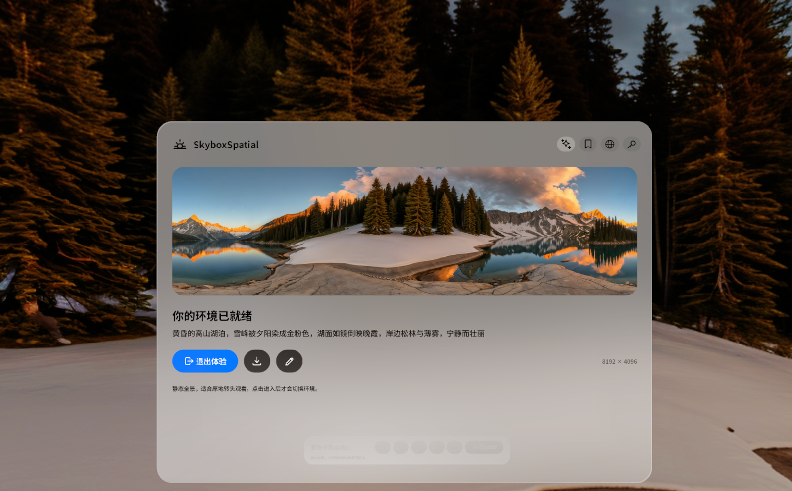
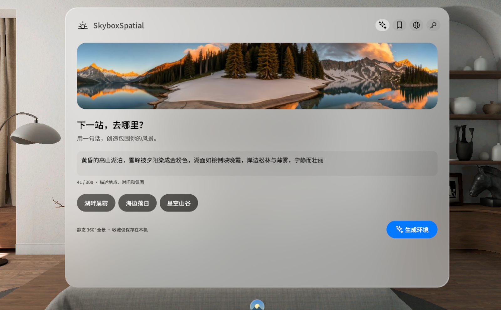
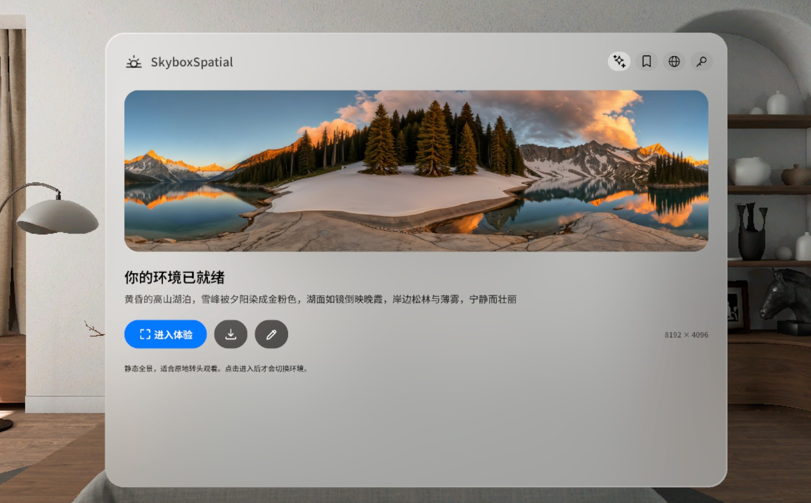
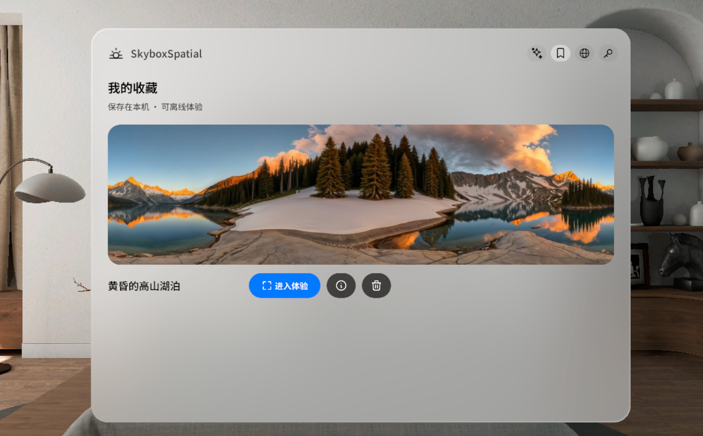

# SkyboxSpatial

One sentence in, a 360° environment around you. A PICO OS 6 spatial app that generates static
panoramas with the Skybox AI service, previews them in a window, opens them as a Full Space, and keeps
favourites on the headset.



| Create | Preview | Library |
| --- | --- | --- |
|  |  |  |

## What it does

- **Create**: describe a place, time and mood (up to 300 characters, three example chips), generate.
  Chinese, Japanese and Korean descriptions go through the service's prompt enhancer, which the image
  model needs; the app keeps showing the user's own words.
  The description survives every failure; a result can be refined again with the previous image as
  the base (Model 3 remix).
- **Preview and enter**: results arrive at native resolution (8K for Model 3 styles). Entering is a
  deliberate tap; the environment never switches on its own. A floating console in the Full Space
  offers save, turn, reset heading, language and exit.
- **Library**: saving writes the image, a thumbnail and the description to the app's storage and a
  copy to `Pictures/SkyboxSpatial`, and only reports success once everything is on disk. Saved
  environments open offline.
- **Settings**: paste your own Skybox AI key (copied from the browser) and pick a style. The key
  stays on the device.
- UI in Chinese and English (Noto Sans SC / Noto Sans), icon navigation, SpatialUI components.

## Build

```bash
./gradlew :app:assembleDebug
```

Requires the PICO Spatial SDK toolchain (BOM 6.1.9). See `AGENTS.md` for the code map, rules and
known gaps.

## License

MIT. Fonts under the SIL Open Font License (see `app/src/main/assets/fonts`).
